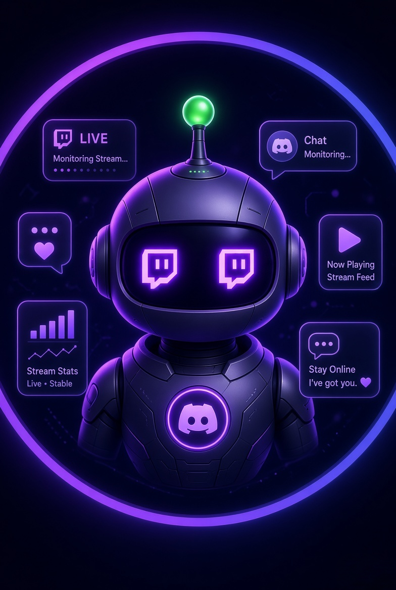

# Twitch Live to Discord



**A cross-platform, dark dashboard that sends Twitch live alerts to the Discord
channels your community actually uses.**

Runs on **Windows, Linux, and macOS** — Windows is not required. The dashboard
is served locally in your browser; Windows adds a native system-tray wrapper. The
whole app is a single static Go binary — no Electron, Node, Python, or external
runtime.

Add as many streamers and labelled Discord webhooks as you want, choose who
posts where, and tune each message with placeholders and a live Discord preview.

[Download the latest release](../../releases/latest) · [Build from source](#building-from-source) · [MIT License](LICENSE)

<br clear="right">


## Why people like it

- **Cross-platform by design.** Windows, Linux, and macOS use the same
  dashboard and monitor. Windows gets an optional tray icon and startup entry.
  Run it 24/7 on a VPS, NAS, or Raspberry Pi with Docker.
- **No Twitch login, bot, or API registration.** Just a Twitch username and a
  Discord webhook.
- **No hardcoded limits.** Follow every channel your community cares about and
  send alerts to multiple Discord servers or channels.
- **Labelled destinations.** Name webhooks things like `Community #live`,
  `Friends & family`, or `Speedruns`.
- **Your message, your style.** Edit the message content, embed title,
  description, footer, colour, fields, and preview image. Use placeholders and
  see a live Discord preview before saving.
- **Dark by default.** A polished dashboard with a light-mode toggle.
- **Once per stream, per destination.** Restarting the app does not repost the
  same stream. A new stream triggers a new alert.
- **Live messages that stay current.** Optionally edit the same Discord message
  while a stream is live so viewers, title, and game stay fresh.
- **Clean stream endings.** Delete the live post, edit it into a stream-ended
  message, or post a separate ending with the last title, game, and VOD link.
- **Your identity, your target.** Override the webhook name and avatar, post into
  an existing thread or forum post, and add link buttons.
- **Route-level templates.** Override a destination's message for one specific
  streamer→destination connection, with conditional fallbacks such as
  `{game|Just Chatting}` and custom embed fields.
- **Optional streamer and role pings.** Associate a streamer with their Discord
  user ID and use `{discord_mention}`, or add role IDs per destination and use
  `{role_mentions}`. `@everyone` and `@here` stay blocked unless a destination
  explicitly opts in.
- **No accidental pings.** Only IDs you explicitly configure can be mentioned,
  so a stream title cannot accidentally ping the whole server.
- **Post on your terms.** Filter by game, title, viewers, quiet hours, allowed
  days, cooldowns, and alert delay, per streamer.
- **Secrets stay private.** Webhook URLs are encrypted at rest with the platform
  keychain or DPAPI where available, and config backups redact them by default.

## Runs on

| Platform | Dashboard | Install | Native tray |
| --- | --- | --- | --- |
| **Windows 10/11 x64** | Browser at `127.0.0.1` | Installer or portable ZIP | Yes |
| **Linux x64** | Browser at `127.0.0.1` | `.deb`, AppImage, or `--serve` | No |
| **macOS Intel / Apple Silicon** | Browser at `127.0.0.1` | `.app` bundle or `--serve` | No |
| **Docker (amd64/arm64)** | Port `8787` | `restart: unless-stopped` | No |

Any 64-bit desktop with a modern browser can run the dashboard. Other Go
architectures can be built from source.

## Quick start

### Windows

1. Download the Windows installer (`TwitchLiveNotifier-vX.Y.Z-Windows-x64-Setup.exe`)
   from the [latest release](../../releases/latest), or use the portable ZIP.
2. Run the installer. It installs per-user, creates a Start Menu shortcut, and
   offers an optional desktop shortcut.
3. Launch it. The dashboard opens in your browser and the app keeps running in
   the tray.
4. Leave it running. Windows SmartScreen may warn for unsigned builds; signed
   releases clear the warning as certificate reputation builds.

Upgrading with the installer does not touch `%APPDATA%\TwitchLiveNotifier`, so
streamers, destinations, templates, and secrets are preserved.

### Linux

1. Download the `.deb` or AppImage from the
   [latest release](../../releases/latest), or run `./build-linux.sh`.
2. Install the deb:
   ```bash
   sudo apt install ./TwitchLiveNotifier-vX.Y.Z-Linux-x64.deb
   systemctl --user enable --now twitch-live-notifier
   ```
   Or run the AppImage:
   ```bash
   chmod +x TwitchLiveNotifier-vX.Y.Z-Linux-x64.AppImage
   ./TwitchLiveNotifier-vX.Y.Z-Linux-x64.AppImage
   ```
3. Open <http://127.0.0.1:8787/>. The desktop entry and AppImage also open the
   dashboard automatically.

### macOS

1. Download the macOS archive from the
   [latest release](../../releases/latest), or run `./build-macos.sh`.
2. Move `Twitch Live to Discord.app` into Applications and launch it, or run the
   raw binary:
   ```bash
   ./TwitchLiveNotifier-macos-arm64 --serve   # Apple Silicon
   ./TwitchLiveNotifier-macos-amd64 --serve   # Intel
   ```
3. The app bundle opens the dashboard automatically. The raw binary prints the
   URL, normally <http://127.0.0.1:8787/>.

The macOS app is unsigned unless Apple Developer signing is configured; see
[docs/signing.md](docs/signing.md). A free source-build path is available through
the Homebrew formula in [packaging/homebrew](packaging/homebrew/).

Then, on any platform:

1. Click **Add destination** and paste a Discord webhook URL.
2. Click **Add streamer** and enter a Twitch username or channel URL.
3. On the streamer card, tick the destinations where that streamer should post.
4. Use **Send sample** to post a clearly marked example, or **Check all now** to
   run a real check.
5. Leave the app running. On Windows that means the tray; on Linux/macOS keep
   `--serve` running as a background service.

### Docker (24/7 self-hosting)

For a VPS, NAS, or Raspberry Pi, run the published multi-arch image:

```bash
git clone https://github.com/ausbitbank/twitch-live-notifier.git
cd twitch-live-notifier
docker compose up -d
```

The dashboard is on <http://127.0.0.1:8787/> by default and settings live in a
persistent volume. The container includes a healthcheck against `/healthz`.
See [docs/docker.md](docs/docker.md) for public-access warnings, SSH tunnels,
updating, backups, ARM notes, and timezone setup for quiet hours.

### Creating a Discord webhook

1. Open Discord and go to your server.
2. Open **Server Settings → Integrations → Webhooks**.
3. Click **New Webhook**, choose the channel, and give it a name.
4. Click **Copy Webhook URL**.
5. Paste it into the destination editor and click **Test webhook**.
6. You need the **Manage Webhooks** permission in that server.

## Destinations and streamer routing

- A **destination** is a labelled Discord webhook. It has its own enabled state
  and message template.
- A **streamer** is a Twitch channel. Each streamer has a checklist of
  destinations.
- The same streamer can post to many destinations. The same destination can
  receive many streamers.
- Pausing a streamer stops automatic checks for it. Pausing a destination stops
  posts to that webhook without losing its template or connections.


## Message templates

Each destination has its own template. The editor includes a live Discord-style
preview using real channel data when available.

| Placeholder | Value |
| --- | --- |
| `{streamer}` | Twitch display name |
| `{title}` | Current stream title |
| `{game}` | Game or category |
| `{url}` | Twitch channel URL |
| `{vod}` | Latest VOD link, when Twitch exposes one |
| `{thumbnail}` | Twitch preview image URL |
| `{viewers}` | Viewer count with thousands separators |
| `{started}` | Stream start date and time |
| `{live_for}` | How long the stream has been live, or `Ended` for a sample |
| `{webhook}` | Destination label |
| `{channel}` | Twitch login name |
| `{discord_mention}` | The streamer's Discord ping, or `@DisplayName` if no ID is set |
| `{role_mentions}` | The destination's configured Discord role pings |

You can also toggle the author, preview image, game field, viewers field, and
live-time field, and choose the embed colour. Unknown placeholders are flagged
in the preview so typos are easy to spot.


### Template power

- Use `{game|Just Chatting}` or `{title|Untitled stream}` to provide a fallback
  when a placeholder is empty.
- Add custom embed fields with `Name | Value | inline` and reorder built-in and
  custom fields with the field-order setting.
- Export the current style as JSON, import it into another destination, or
  duplicate a destination and give it a new webhook URL.
- A streamer→destination route can override the destination template without
  changing any other route. Mention controls stay destination-wide.

## Stream lifecycle

Each streamer→destination route remembers the Discord message it posted. The
message ID, original webhook URL, and thread ID are stored so later edits and
cleanup target the original post even if the destination URL changes later.

| Setting | Behavior |
| --- | --- |
| **Update the live message** | Edits the same message every 1–30 minutes while live. Off leaves it untouched. |
| **Leave the live message** | Do nothing when the stream ends. |
| **Delete the live message** | Deletes the original post. |
| **Edit it into an ended message** | Replaces the live post with the stream-ended template. |
| **Post a separate ended message** | Leaves the live post and posts an ended message. |

The ended template has its own content, title, description, footer, colour, and
`{vod}` link. Pings are off by default for ended messages. A cleanup or edit
failure is logged and retried without blocking the next stream.

## Custom identity and thread targets

- **Webhook name** and **avatar URL** override the destination's appearance in
  Discord.
- **Thread ID** posts into an existing thread or forum post. Message edits and
  cleanup use the original thread even if the destination setting changes.
- **Link buttons** add up to five link buttons below the embed. Labels and URLs
  accept placeholders.

## Optional Discord pings

### Streamer ping

Each streamer can have an optional Discord user ID. When configured, the
`{discord_mention}` placeholder becomes a real `<@user>` mention that pings the
streamer in Discord.

1. In Discord, open **Settings → Advanced** and enable **Developer Mode**.
2. Right-click the streamer's name and choose **Copy User ID**.
3. In the app, open **Streamers**, click **Add** next to **Discord ping**, and
   paste the ID.
4. Add `{discord_mention}` to the **message content** of a destination template.

Only that one user mention is allowed. If a streamer has no Discord ID,
`{discord_mention}` falls back to plain `@DisplayName` text and does not ping
anyone.


### Role ping

Each destination can ping up to ten Discord roles. Enable **Developer Mode**,
right-click the role, choose **Copy Role ID**, and paste the IDs into
**Mention controls** on the destination editor. Then add `{role_mentions}` to
the message.

The `allowed_mentions.roles` payload contains exactly those configured IDs.
Any other role mention is inert, even if someone types it into the template.

### Mention safety

- `@everyone` and `@here` are blocked by default.
- A destination can explicitly enable them under **Mention controls**. The
  dashboard asks for confirmation, and the setting is stored per destination.
- The live preview lists exactly which users, roles, and broad mentions will
  ping, and warns when a mention is present but blocked.

## Monitoring

- The default check interval is **2 minutes**. You can change it in Settings.
- Monitoring runs from the app process, even if the browser tab is closed.
- The app checks every enabled streamer and posts to each connected destination
  only once per Twitch stream.
- Live message edits and stream-end cleanup use the stored message ID, original
  webhook URL, and thread ID. A cleanup failure does not block the next stream.
- Failed Twitch checks retry a few times with jittered backoff. Discord `429`
  responses are handled per destination:
  - short delays are retried inline once;
  - long delays are persisted as a `retry_until` window and the destination is
    skipped until it expires;
  - proactive `X-RateLimit-Remaining` / `X-RateLimit-Reset-After` headers are
    honored, and fallback delays are jittered.
  - A scheduled or manual check has a 15-minute hard timeout.
- When a destination is rate limited, the destination card and the streamer's
  routing row show **Rate limited** and the retry time. A rate-limited post does
  not record dedupe, so it is retried after the window without losing the alert.
- A webhook that returns `401`, `403`, or `404` is marked **Invalid** and
  skipped so the app does not hammer Discord. Fix the URL and use **Test
  webhook** to clear it. Other destinations keep working.
- Use **Check all now** for an immediate pass, or **Check now** on one streamer.
- Only one instance can use a settings file at a time. Starting a second
  `--serve` opens the existing dashboard instead of double-posting; a
  `--check` against a running instance skips safely.
- **Pause monitoring** stops automatic checks but still allows manual checks.
- On Windows, **Start with Windows** launches the app quietly in the tray.
  Linux and macOS use systemd/launchd as described below.
- `GET /healthz` reports whether the monitor is alive, with the last check time,
  uptime, pause state, and counts. It returns HTTP 503 when checks are stale.
  Docker uses this endpoint for its built-in healthcheck, so it stays reachable
  even when a dashboard token is set.
- **Updates:** the app checks the latest GitHub release once a day and from
  Settings. It reports the current version, latest version, and a download link.
  It never silently replaces its own binary. Turn the check off in Settings if
  you do not want the outbound GitHub request.

## Notification filters and quiet hours

Every streamer has its own **Alert filters**, edited from the streamer card.
Filters decide whether a live stream posts; they never hide the live status.

- **Games/categories:** only these, or never these. Matching is
  case-insensitive and contains the text. Excludes always win over includes.
- **Title keywords:** title must contain, or must not contain.
- **Minimum viewers:** skip low-viewer streams.
- **Alert delay:** wait until the stream has been live for N minutes.
- **Quiet hours:** a local-time window, including windows that cross midnight.
- **Allowed days:** post only on selected weekdays. Empty means every day.
- **Cooldown:** minimum minutes between new-stream alerts.
- **First stream of the day:** post at most once per local calendar day.

Quiet hours, allowed days, cooldowns, and first-of-day use the app's local
timezone. In Docker, set `TZ` (for example `TZ=Europe/London`); the default is
UTC.

A filtered stream still updates the dashboard and still respects dedupe. The
streamer card shows **Not posting** with the reason, so a quiet-hours or
viewer-threshold skip is easy to spot. Removing or relaxing a filter while the
stream is still live allows the alert to post on the next check.

## Settings and privacy

Settings are stored in the current user's profile:

| Platform | Settings folder |
| --- | --- |
| Windows | `%APPDATA%\TwitchLiveNotifier\` |
| Linux | `~/.config/TwitchLiveNotifier/` |
| macOS | `~/Library/Application Support/TwitchLiveNotifier/` |
| Docker | `/data/` in the `twitch-live-data` volume |

The folder contains your streamers, routing choices, templates, filters, and the
last stream posted to each destination. Webhook URLs are moved into
`secrets.json`, encrypted with DPAPI on Windows, Keychain on macOS, or libsecret
on Linux when available. When no keyring is available, a private `secret.key`
file is used as the fallback. A Discord webhook URL is a credential: anyone with
it can post to that channel. Keep the whole folder private, and do not share
unmasked screenshots or bug reports.

Settings includes **Download backup**, **With secrets**, and **Restore backup**.
The normal backup redacts webhook URLs; the with-secrets backup contains live
credentials and should be treated like a password. Restoring a redacted backup
asks you to re-enter each webhook URL. Backups never include the dashboard
token, so set it again after restoring. To move a configuration to another
machine, use a with-secrets backup or copy the whole settings folder.

If you expose the dashboard beyond `127.0.0.1`, set a **Dashboard token** under
Settings. The token is required for API access; `/healthz` stays public for
Docker health checks.

The app has no analytics, telemetry, or silent auto-updater. It talks directly
to Twitch and Discord. When update checks are enabled, it also requests the
latest release metadata from GitHub. By default the dashboard is served only on
`127.0.0.1` and is not exposed to your network. The Docker image listens on `0.0.0.0` inside the
container, but the compose file publishes it on loopback by default; see
[docs/docker.md](docs/docker.md) before exposing it. Twitch is checked through
Twitch's public web GraphQL endpoint; no Twitch account or OAuth token is used.

## Running in the background on Linux/macOS

The `--serve` mode is intentionally simple. To keep it running at login, use the
service manager built into your OS.

### Linux systemd

```ini
[Unit]
Description=Twitch Live to Discord dashboard
After=network-online.target
Wants=network-online.target

[Service]
ExecStart=/path/to/TwitchLiveNotifier-linux-amd64 --serve
Restart=on-failure

[Install]
WantedBy=default.target
```

Save as `~/.config/systemd/user/twitch-live-notifier.service`, then:

```bash
systemctl --user daemon-reload
systemctl --user enable --now twitch-live-notifier
xdg-open http://127.0.0.1:8787/
```

### macOS launchd

Create `~/Library/LaunchAgents/com.twitch-live-to-discord.plist`:

```xml
<?xml version="1.0" encoding="UTF-8"?>
<!DOCTYPE plist PUBLIC "-//Apple//DTD PLIST 1.0//EN"
  "http://www.apple.com/DTDs/PropertyList-1.0.dtd">
<plist version="1.0">
<dict>
  <key>Label</key><string>com.twitch-live-to-discord</string>
  <key>ProgramArguments</key>
  <array>
    <string>/path/to/TwitchLiveNotifier-macos-arm64</string>
    <string>--serve</string>
  </array>
  <key>RunAtLoad</key><true/>
</dict>
</plist>
```

Then load it:

```bash
launchctl load ~/Library/LaunchAgents/com.twitch-live-to-discord.plist
open http://127.0.0.1:8787/
```

## Command line

The dashboard is the normal way to use the app. These modes are useful for
diagnostics and background setups:

```text
TwitchLiveNotifier[.exe]
    Windows: open the dashboard and keep monitoring in the tray.
    Linux/macOS: start the dashboard and open the browser.

TwitchLiveNotifier[.exe] --background
    Windows: start in the tray without opening the browser. Used at login.

TwitchLiveNotifier[.exe] --check
    Check every streamer once, post any pending alerts, and exit.

TwitchLiveNotifier[.exe] --serve
    Run the dashboard in the foreground without opening a browser.

TwitchLiveNotifier[.exe] --healthcheck
    Probe the local /healthz endpoint and exit. Used by Docker.
```

Options:

| Option | Description |
| --- | --- |
| `--config PATH` | Use a custom settings file. |
| `--listen ADDR` | Dashboard listen address, e.g. `127.0.0.1:8787` or `0.0.0.0:8787`. |
| `--healthcheck-url URL` | Health URL used by `--healthcheck`. |
| `--version` | Print the version. |
| `--help`, `-h` | Show help. |

## Building from source

Requires Go 1.22 or newer.

Cross-compile Windows from Linux/macOS:

```bash
./build.sh
```

Windows PowerShell:

```powershell
.\build.ps1
```

The Windows result is written to `dist/TwitchLiveNotifier.exe`. The icon,
manifest, and version metadata are embedded from `rsrc_windows_amd64.syso`.

Linux build:

```bash
./build-linux.sh
```

macOS builds:

```bash
./build-macos.sh
```

Packages:

```bash
# Linux .deb / AppImage (AppImage needs appimagetool)
./packaging/linux/build-deb.sh 2.4.0
APPIMAGETOOL=/path/to/appimagetool ./packaging/linux/build-appimage.sh 2.4.0

# macOS .app bundle for either arch
./packaging/macos/build-app.sh 2.4.0 arm64 dist/TwitchLiveNotifier-macos-arm64

# Windows installer (on Windows, with Inno Setup 6)
.\packaging\windows\build-installer.ps1 -Version 2.4.0
```

Docker:

```bash
docker build -t twitch-live-notifier .
# or
docker compose up -d --build
```

The release workflow builds Windows x64 (installer + ZIP), Linux x64
(`.deb` + AppImage), macOS Intel/Apple Silicon (`.app` + binaries), winget
manifests, and multi-arch Docker images from a tag. See
[Signing and packaging](docs/signing.md) for optional certificate secrets.

To regenerate the app icon, web assets, and Windows resources after changing
the artwork or version:

```bash
./tools/generate-resources.sh
```

This requires `go-winres` and ImageMagick.

## Limitations

- Requires an internet connection.
- Twitch can change its private web endpoint or public web client ID at any
  time. If that happens, the app will need an update.
- Polling is every two minutes by default, so very short streams can be missed.
- Webhook URLs are encrypted at rest where an OS keyring is available. Without a
  keyring, a 0600 fallback key file is only as private as the settings folder.
- The dashboard has no login by default. Set a dashboard token if needed, and
  keep it on loopback, behind an SSH tunnel, or behind an authenticating reverse
  proxy. Do not publish port 8787 directly.
- Release artifacts are unsigned unless the repository signing secrets are
  configured. Unsigned Windows builds may trigger SmartScreen, and unsigned
  macOS bundles may require a Gatekeeper override.
- The app checks for updates but does not auto-install them. A self-replacing
  updater will wait for signed artifacts and signature verification.
- Windows includes a native tray icon. Linux and macOS currently run as a local
  browser dashboard and do not have native tray integration.
- Live-role automation and schedule sync are not implemented; those need an
  optional Discord bot mode.
- When no OS keyring is available, the fallback `secret.key` protects the
  encrypted URLs only as well as the local file permissions. Keep the settings
  folder private.
- Prebuilt artifacts are 64-bit Windows/Linux and Intel/Apple Silicon macOS.
  Docker images cover `linux/amd64` and `linux/arm64`; other Go targets can be
  built from source.

## Code signing policy

Free code signing provided by [SignPath.io](https://about.signpath.io),
certificate by [SignPath Foundation](https://signpath.org). Release signing is
limited to artifacts built from this public repository and manually approved by
the maintainer. See [CODE_SIGNING.md](CODE_SIGNING.md) for roles, privacy, and
uninstallation details.

Windows signing through SignPath Foundation is subject to their eligibility
review. macOS Developer ID signing and notarization require a paid Apple
Developer Program membership; the free macOS path is a source/Homebrew install
or running an unsigned app with a Gatekeeper override.

## Roadmap and research

- [Public roadmap](docs/roadmap.md)
- [Docker and self-hosting](docs/docker.md)
- [Signing and packaging](docs/signing.md)
- [Competitive research and sources](docs/competitive-research.md)
- [Clean-session project brief](docs/project-context.md)

Issues and feature suggestions are welcome.

## Disclaimer

Twitch and Discord are trademarks of their respective owners. This project is
not affiliated with or endorsed by Twitch or Discord.

## License

MIT. See [LICENSE](LICENSE).
