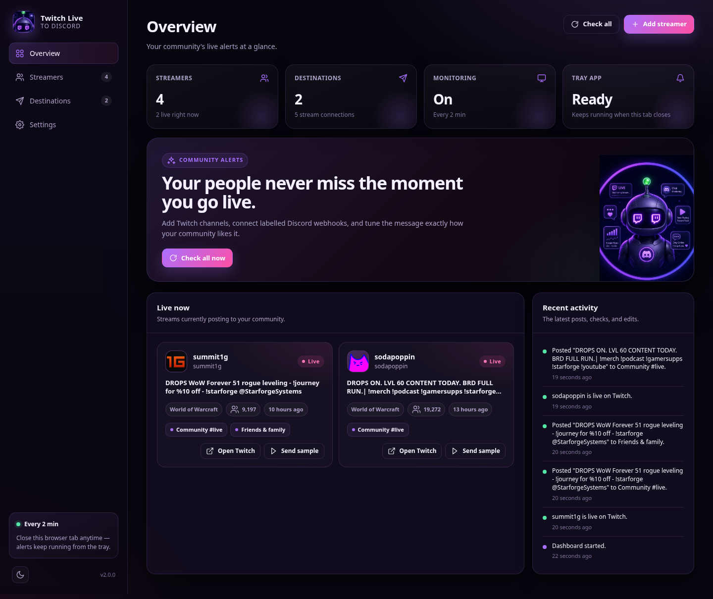
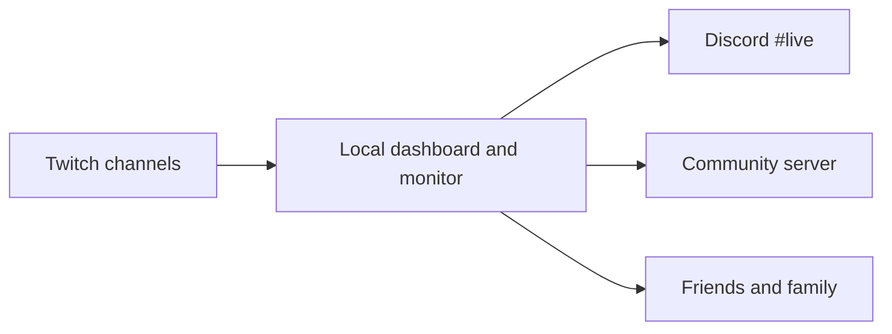
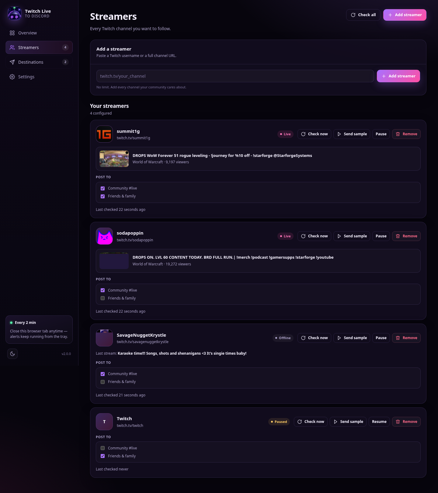
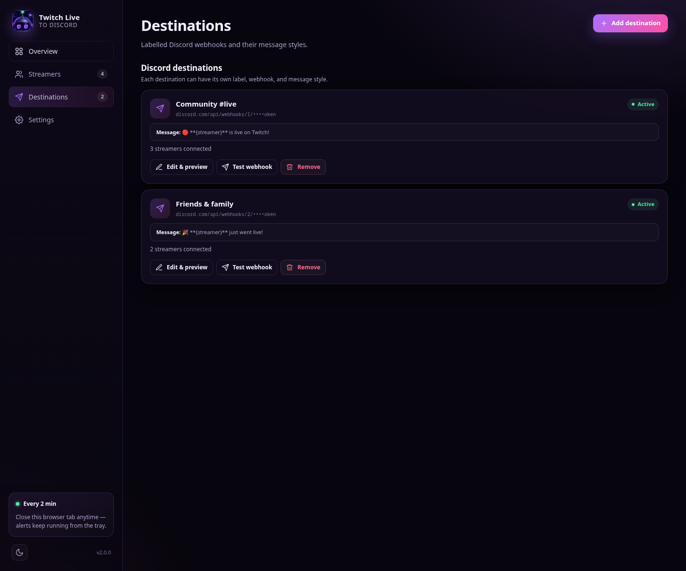
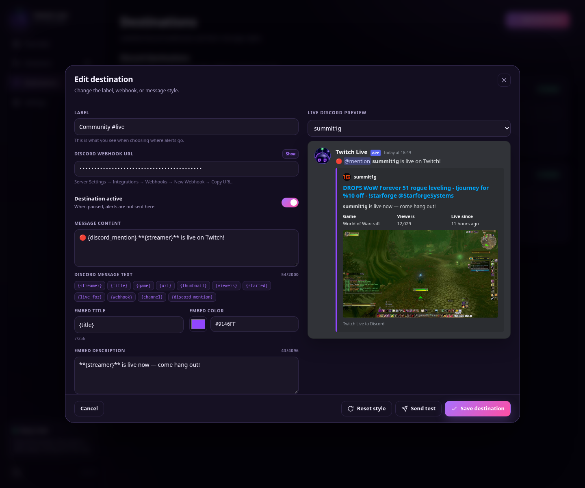

<p align="center">
  
</p>

<h1 align="center">Twitch Live to Discord</h1>

<p align="center">
  <strong>Twitch live alerts in Discord — without a bot, OAuth, or cloud account.</strong><br>
  A private, local-first dashboard for communities that follow many streamers and post to several Discord channels.
</p>

<p align="center">
  <a href="https://github.com/ausbitbank/twitch-live-notifier/actions/workflows/ci.yml"></a>
  <a href="https://github.com/ausbitbank/twitch-live-notifier/releases/latest"></a>
  <a href="LICENSE"></a>
  <a href="go.mod"></a>
  <br>
  
  <a href="https://github.com/ausbitbank/twitch-live-notifier/pkgs/container/twitch-live-notifier"></a>
  <a href="#why-this-exists"></a>
  <a href="https://github.com/ausbitbank/twitch-live-notifier/releases"></a>
</p>

<p align="center">
  <a href="https://github.com/ausbitbank/twitch-live-notifier/releases/latest"></a>
  <a href="https://github.com/ausbitbank/twitch-live-notifier/releases/latest"></a>
  <a href="https://github.com/ausbitbank/twitch-live-notifier/releases/latest"></a>
  <a href="docs/docker.md"></a>
</p>

<p align="center">
  <a href="#quick-start">Quick start</a> ·
  <a href="#screenshots">Screenshots</a> ·
  <a href="#common-questions">FAQ</a> ·
  <a href="#feature-list">Feature list</a> ·
  <a href="#technical-details">Technical details</a>
</p>

<p align="center">
  
</p>

> [!IMPORTANT]
> **The app must stay running on a computer that is online.**
> If that computer sleeps, shuts down, or loses internet, Twitch checks stop and
> Discord alerts are missed until it comes back. Closing the browser tab is fine;
> quitting the app is not. For 24/7 alerts, run it on a VPS, NAS, or Raspberry Pi
> with Docker.

> [!NOTE]
> **Downloads:** The buttons open the latest published release. The Windows
> installer, portable ZIP, Linux packages, macOS app bundles, and Docker image
> are attached to each release.

## Why this exists

Most Twitch-to-Discord bots require inviting a bot, granting OAuth access, or
trusting a cloud service with your community's configuration. This app takes a
smaller approach:

- **Bring your own Discord webhook.** No bot to invite, no Discord application,
  no OAuth consent screen.
- **Bring a Twitch username.** No Twitch login, API key, or application
  registration.
- **Keep it local.** The dashboard and settings live on your machine. The app
  talks directly to Twitch and Discord.
- **Route alerts your way.** One streamer can post to many labelled destinations;
  one destination can receive many streamers.
- **Make the message yours.** Per-destination and per-route templates, live
  preview, safe mentions, filters, quiet hours, and stream lifecycle actions.

## How it works



The dashboard is the control panel. The monitor runs in the same app process and
posts to whichever Discord webhooks you connect. There is no cloud relay in the
middle.

## Quick start

### What you need

- A Discord server where you can create a webhook
  (**Manage Webhooks** permission).
- One or more Twitch channel names or channel URLs.
- A computer that can stay on and online while you want alerts. This can be your
  desktop, a spare machine, a NAS, a Raspberry Pi, or a VPS.

You do **not** need a Discord bot, a Twitch account, Twitch OAuth, or a cloud
account.

### 1. Create a Discord webhook

1. Open Discord and go to your server.
2. Open **Server Settings → Integrations → Webhooks**.
3. Click **New Webhook**, choose the channel, and give it a name.
4. Click **Copy Webhook URL**.
5. Keep that URL private. Anyone with it can post to that channel.

> [!TIP]
> You can make one webhook per Discord channel, and you can paste the same
> webhook URL into several destinations if you want different messages for
> different streamers.

### 2. Install the app

Choose the option that matches your computer:

| Platform | Easiest option | Also works |
| --- | --- | --- |
| **Windows 10/11 64-bit** | Windows installer | Portable ZIP |
| **Ubuntu / Debian** | `.deb` package | Linux `.tar.gz` |
| **Other Linux** | AppImage | Linux `.tar.gz` |
| **macOS Intel / Apple Silicon** | `.app` bundle in the macOS archive | Raw binary with `--serve` |
| **VPS / NAS / Raspberry Pi** | Docker image | Linux binary + systemd |

Portable options do not need an installer:

- **Windows ZIP:** extract it and run `TwitchLiveNotifier.exe`. The app opens the
  dashboard and keeps running in the tray.
- **Linux archive:** extract it and run
  `./TwitchLiveNotifier-linux-amd64 --serve`. Open the URL it prints.
- **macOS archive:** open `Twitch Live to Discord.app`, or run the raw binary
  with `--serve`. If Gatekeeper blocks an unsigned download, right-click →
  **Open**, or build from source with the included Homebrew formula.
- **Docker:** run `docker compose up -d` from a checkout. See
  [Docker and self-hosting](docs/docker.md).

Open <http://127.0.0.1:8787/> (or the URL printed in the terminal).

### 3. Add your first alert

1. Click **Add destination**, paste the Discord webhook URL, and click
   **Test webhook**.
2. Click **Add streamer** and enter a Twitch username or channel URL.
3. On the streamer card, tick the destinations where that streamer should post.
4. Click **Send sample** to post a clearly marked example.
5. Click **Check all now** to run a real check.

That is the whole setup. You can add more streamers and destinations at any
time, and each destination can have its own message style.

### 4. Leave it running

- **Closing the browser tab is fine.** Monitoring runs in the app process.
- **Quitting the app stops checks.** On Windows, keep it in the tray. On
  Linux/macOS, keep `--serve` running as a service.
- **Sleeping the computer stops checks.** For 24/7 alerts, use Docker on an
  always-on host.
- A **health endpoint** at `/healthz` reports whether the monitor is alive and
  when it last checked.

## Will this work for me?

| I want to… | Supported? |
| --- | --- |
| Alert a Discord channel without adding a bot | **Yes** |
| Follow many Twitch channels | **Yes** |
| Send one streamer to several Discord channels | **Yes** |
| Send different messages to different channels | **Yes** |
| Ping a streamer or an `@Live` role safely | **Yes, scoped** |
| Filter by game, title, viewers, day, or time | **Yes** |
| Avoid posting during quiet hours | **Yes** |
| Edit or delete the live message when a stream ends | **Yes** |
| Run 24/7 without my desktop being awake | **Yes, with Docker on an always-on host** |
| Assign Discord roles or sync schedules | **Not yet** — those need an optional bot mode |
| Use a hosted cloud service | **No** — this is local-first by design |

## Screenshots

| Overview | Streamers and routing |
| --- | --- |
|  |  |

| Destinations | Message editor and live preview |
| --- | --- |
|  |  |

### Discord ping settings


## Common questions

### Do I need a Discord bot?

No. The app posts through Discord webhooks. You create a webhook in the channel
you want to use and paste the URL into the app.

### Do I need a Twitch account or API key?

No. The app reads public channel data from Twitch's web endpoint. There is no
Twitch login or OAuth flow.

### Does my computer need to stay on?

Yes. The app is the monitor. If the host sleeps, shuts down, or loses internet,
checks stop and alerts are missed. Closing the browser tab is fine; quitting the
app or sleeping the computer is not.

### Will it post the same stream twice?

No. Each streamer→destination route remembers the last stream it posted, so
restarting the app or pressing **Check all now** does not repost the same
stream. A new Twitch stream triggers a new alert.

### Can I post to more than one Discord server or channel?

Yes. Add as many destinations as you want. A streamer can post to several
destinations, and a destination can receive several streamers.

### Can I customise the message per Discord channel?

Yes. Every destination has its own template and live preview. You can also
override the template for one specific streamer→destination route.

### Can it ping a role or the streamer?

Yes, but only IDs you explicitly configure. `{discord_mention}` pings the
streamer when a Discord user ID is set. `{role_mentions}` pings the roles
configured on that destination. `@everyone` and `@here` stay blocked unless a
destination explicitly opts in.

### Can it edit or delete the live post when the stream ends?

Yes. Per destination, you can leave the post, delete it, edit it into a
stream-ended message, or post a separate ended message with the last title/game
and VOD link when available.

### Does it use a cloud service or analytics?

No. There is no analytics, telemetry, or cloud relay. The app talks directly to
Twitch and Discord. When update checks are enabled, it also requests the latest
release metadata from GitHub; you can turn that off in Settings.

### Why does Windows SmartScreen or macOS Gatekeeper warn me?

Release artifacts are unsigned unless signing certificates are configured.
SmartScreen and Gatekeeper may warn on unsigned builds. Windows signing can use
free OSS options such as SignPath Foundation or OSSign when the project is
eligible; macOS Developer ID signing requires a paid Apple Developer Program
membership. See [docs/signing.md](docs/signing.md).

### How often does it check Twitch?

Every **2 minutes** by default. You can change the interval in Settings; the
minimum is 30 seconds. Very short streams can still be missed by polling.

## Project status

| | |
| --- | --- |
| **Latest published release** | [GitHub Releases](https://github.com/ausbitbank/twitch-live-notifier/releases/latest) — the release badge above shows the current tag |
| **`main` branch** | Post-v2.4.0; CI is green |
| **Next release** | v2.5.0 / future focus |
| **Roadmap** | [docs/roadmap.md](docs/roadmap.md) |
| **Changelog** | [CHANGELOG.md](CHANGELOG.md) |

The latest release includes the stream lifecycle, per-route templates, secret
storage, scoped mention controls, installers and packages, the GitHub release
update check, and hardened Discord rate-limit handling.

## Feature list

Features are in the latest release.

### Setup and routing

- Unlimited Twitch streamers and unlimited labelled Discord webhook
  destinations.
- Per-streamer destination checklist: one streamer → many destinations, one
  destination → many streamers.
- Pause a streamer or a destination without losing its settings.
- Add streamers from a username, `twitch.tv` URL, or mobile URL.
- Add destinations by paste-in Discord webhook URL.
- Test a webhook, send a last-stream sample, or run a check immediately.

### Messages and Discord

- Per-destination message content, embed title, description, footer, colour,
  author, image, game, viewers, and live-time fields.
- Live Discord-style preview using real channel data when available.
- Placeholders for streamer, title, game, URL, VOD, thumbnail, viewers, start
  time, live duration, destination label, and channel login.
- Conditional fallbacks such as `{game|Just Chatting}`.
- Per-route template overrides.
- Custom embed fields and configurable field order.
- Template import/export and duplicate-destination workflow.
- Per-destination webhook name and avatar overrides.
- Post into an existing Discord thread or forum post with a thread ID.
- Up to five link buttons with placeholders in labels and URLs.

### Stream lifecycle

- Store the Discord message ID, original webhook URL, and thread ID for every
  streamer→destination route.
- Edit the same live message at a configurable interval so viewers/title/game
  stay current.
- On stream end: leave the live post, delete it, edit it into an ended message,
  or post a separate ended message.
- Ended messages can include the last title/game and `{vod}` link.
- Cleanup and edit failures are logged and retried without blocking the next
  stream.

### Mentions and safety

- Optional streamer Discord user ID with `{discord_mention}`.
- Optional role IDs per destination with `{role_mentions}`.
- `allowed_mentions` contains only configured users/roles.
- `@everyone` and `@here` are blocked by default and require an explicit
  per-destination opt-in with confirmation.
- Preview lists exactly what will ping and warns about blocked mentions.

### Filters and timing

- Include/exclude game or category rules.
- Include/exclude title keywords.
- Minimum viewer count.
- Alert delay after going live.
- Quiet hours, including windows that cross midnight.
- Allowed weekdays.
- Per-streamer cooldown between new-stream alerts.
- Optional first-stream-of-the-day mode.
- Filtered streams still update live status and keep dedupe intact.

### Reliability

- Per-stream, per-destination dedupe that survives restarts.
- Bounded Twitch retries with jittered exponential backoff.
- Discord `429` handling with short inline retries and persisted per-destination
  retry windows.
- Proactive Discord `X-RateLimit-*` handling and jittered fallback delays.
- `401`/`403`/`404` destinations are marked invalid and skipped until repaired.
- Per-destination last success, last error, failure count, and invalid state.
- Cross-platform single-instance locking.
- `/healthz` with liveness, last-check age, uptime, pause state, and counts.
- 15-minute check timeout for scheduled and manual checks.

### Privacy and configuration

- Local-only dashboard on `127.0.0.1` by default.
- No analytics, telemetry, or cloud relay.
- Webhook URLs encrypted at rest with the OS keychain/DPAPI where available, or
  a private fallback key file.
- Redacted-by-default config export, explicit with-secrets export, and restore
  from Settings.
- Optional dashboard token for API access when the dashboard is exposed beyond
  loopback.
- Optional update check that reports the latest GitHub release; no silent
  self-replacing updater.

### Platforms and packaging

- Windows tray app with optional start-at-login.
- Linux/macOS dashboard mode with `--serve`.
- Windows installer and portable ZIP.
- macOS Intel and Apple Silicon `.app` bundles.
- Linux `.deb` and AppImage packages.
- winget manifests in the release assets.
- Multi-arch Docker images for `linux/amd64` and `linux/arm64`.
- Docker healthcheck and persistent config volume.

## Limitations and things to know

- **The app and host must stay online.** This is the most important operational
  requirement. A sleeping laptop or stopped container cannot post alerts.
- Polling defaults to 2 minutes, so very short streams can be missed.
- Twitch can change its private web endpoint or public web client ID. If that
  happens, the app needs an update.
- Live-role automation and Discord scheduled-event sync are not implemented;
  those need an optional bot mode.
- The dashboard has no login by default. Set a dashboard token if needed, keep it
  on loopback, or put it behind an authenticating reverse proxy. Do not publish
  port 8787 directly.
- Release artifacts are unsigned unless signing is configured. Unsigned Windows
  builds may trigger SmartScreen; unsigned macOS apps may require a Gatekeeper
  override.
- Without an OS keyring, the fallback `secret.key` protects encrypted webhook
  URLs only as well as the local file permissions. Keep the settings folder
  private.
- Prebuilt artifacts are 64-bit Windows/Linux and Intel/Apple Silicon macOS.
  Other Go targets can be built from source. Docker covers `linux/amd64` and
  `linux/arm64`.

## Technical details

<details>
<summary><strong>Architecture and runtime</strong></summary>

- Go 1.22+ standard library; no Electron, Node, Python, or external runtime.
- Embedded HTML/CSS/JS dashboard via `go:embed web`.
- Native Win32 tray/message-box code for Windows.
- Browser dashboard and JSON API on all platforms.
- Twitch is checked through Twitch's public web GraphQL endpoint. No Twitch
  OAuth token or bot is used.
- Discord delivery uses webhook `POST`, `PATCH`, and `DELETE` calls.
- Monitoring runs in the app process, not in the browser tab.
- Default poll interval: **120 seconds**; minimum 30 seconds.
- Single instance per settings file: Unix `flock`, Windows named mutex.

</details>

<details>
<summary><strong>Configuration, secrets, and backups</strong></summary>

| Platform | Settings folder |
| --- | --- |
| Windows | `%APPDATA%\TwitchLiveNotifier\` |
| Linux | `~/.config/TwitchLiveNotifier/` |
| macOS | `~/Library/Application Support/TwitchLiveNotifier/` |
| Docker | `/data/` in the `twitch-live-data` volume |

The folder contains `config.json`, `secrets.json`, and (when no OS keyring is
available) `secret.key`. Config schema is version 4; version 3 configs load
automatically.

**Download backup** redacts webhook URLs. **With secrets** includes them and
should be treated like a password. **Restore backup** imports a backup; redacted
webhook URLs must be re-entered. Backups never include the dashboard token.

Set a dashboard token under **Settings** if the dashboard is exposed beyond
loopback. `/healthz` stays public for Docker health checks.

</details>

<details>
<summary><strong>Rate limits and delivery</strong></summary>

- Dedupe is per stream, per destination, and survives restarts.
- A failed post does not record dedupe, so the next check retries it.
- Discord `429` responses honor `Retry-After` / `retry_after`.
- Short rate-limit windows retry inline once; long windows persist
  `retry_until` on that streamer→destination route and defer to a later check.
- Proactive `X-RateLimit-Remaining` / `X-RateLimit-Reset-After` headers are
  honored.
- Per-destination `retry_until` and rate-limit badges are visible in the
  dashboard.
- `401`/`403`/`404` mark a destination invalid and skip it until the URL changes
  or a test succeeds.
- Scheduled and manual checks have a 15-minute timeout.
- The check loop is still sequential; a full persistent post queue/worker pool
  per destination is future work.

</details>

<details>
<summary><strong>Command line</strong></summary>

```text
TwitchLiveNotifier[.exe]
    Windows: open the dashboard and keep monitoring in the tray.
    Linux/macOS: start the dashboard and open the browser.

TwitchLiveNotifier[.exe] --background
    Windows: start in the tray without opening the browser. Used at login.

TwitchLiveNotifier[.exe] --check
    Check every streamer once, post pending alerts, and exit.

TwitchLiveNotifier[.exe] --serve
    Run the dashboard in the foreground without opening a browser.

TwitchLiveNotifier[.exe] --healthcheck
    Probe the local /healthz endpoint and exit. Used by Docker.
```

| Option | Description |
| --- | --- |
| `--config PATH` | Use a custom settings file. |
| `--listen ADDR` | Dashboard listen address, e.g. `127.0.0.1:8787` or `0.0.0.0:8787`. |
| `--healthcheck-url URL` | Health URL used by `--healthcheck`. |
| `--version` | Print the version. |
| `--help`, `-h` | Show help. |

</details>

<details>
<summary><strong>Template placeholders</strong></summary>

| Placeholder | Value |
| --- | --- |
| `{streamer}` | Twitch display name |
| `{title}` | Current stream title |
| `{game}` | Game or category |
| `{url}` | Twitch channel URL |
| `{vod}` | Latest VOD link, when Twitch exposes one |
| `{thumbnail}` | Twitch preview image URL |
| `{viewers}` | Viewer count with thousands separators |
| `{started}` | Stream start date and time |
| `{live_for}` | How long the stream has been live, or `Ended` for a sample |
| `{webhook}` | Destination label |
| `{channel}` | Twitch login name |
| `{discord_mention}` | The streamer's Discord ping, or `@DisplayName` if no ID is set |
| `{role_mentions}` | The destination's configured Discord role pings |

Use `{game|Just Chatting}` or `{title|Untitled stream}` for a fallback when a
placeholder is empty.

</details>

<details>
<summary><strong>Running as a service</strong></summary>

Linux systemd user unit:

```ini
[Unit]
Description=Twitch Live to Discord dashboard
After=network-online.target
Wants=network-online.target

[Service]
ExecStart=/path/to/TwitchLiveNotifier-linux-amd64 --serve
Restart=on-failure

[Install]
WantedBy=default.target
```

Save it as `~/.config/systemd/user/twitch-live-notifier.service`, then run:

```bash
systemctl --user daemon-reload
systemctl --user enable --now twitch-live-notifier
```

macOS launchd agent:

```xml
<?xml version="1.0" encoding="UTF-8"?>
<!DOCTYPE plist PUBLIC "-//Apple//DTD PLIST 1.0//EN"
  "http://www.apple.com/DTDs/PropertyList-1.0.dtd">
<plist version="1.0">
<dict>
  <key>Label</key><string>com.twitch-live-to-discord</string>
  <key>ProgramArguments</key>
  <array>
    <string>/path/to/TwitchLiveNotifier-macos-arm64</string>
    <string>--serve</string>
  </array>
  <key>RunAtLoad</key><true/>
</dict>
</plist>
```

Save it as `~/Library/LaunchAgents/com.twitch-live-to-discord.plist`, then run
`launchctl load ~/Library/LaunchAgents/com.twitch-live-to-discord.plist`.

</details>

<details>
<summary><strong>HTTP API</strong></summary>

- `GET /api/state` — full dashboard state.
- `GET /healthz` — monitor health, last check, counts; HTTP 200/503.
- `POST /api/channels`, `PUT/DELETE /api/channels/{id}` — streamers, routing,
  Discord pings, filters.
- `POST /api/channels/{id}/check`, `/sample` — immediate check or sample post.
- `PUT /api/channels/{id}/destinations` — destination routing.
- `PUT /api/channels/{id}/destinations/{webhookID}` — route template override.
- `POST /api/webhooks`, `PUT/DELETE /api/webhooks/{id}` — destinations.
- `POST /api/webhooks/{id}/test` — test a webhook.
- `POST /api/preview` — render a template preview.
- `GET /api/updates`, `POST /api/updates/check` — update status.
- `GET /api/config/export`, `POST /api/config/import` — backups.
- `PUT /api/dashboard-token` — optional API token.
- `POST /api/check`, `PUT /api/settings`, `/api/open-data-folder`, `/api/quit`.

</details>

<details>
<summary><strong>Building and packaging</strong></summary>

Requires Go 1.22 or newer.

```bash
# Windows cross-compile
./build.sh

# Windows PowerShell
.\build.ps1

# Linux
./build-linux.sh

# macOS binaries and .app bundles
./build-macos.sh
```

Packages:

```bash
# Linux .deb / AppImage (AppImage needs appimagetool)
./packaging/linux/build-deb.sh 2.4.0
APPIMAGETOOL=/path/to/appimagetool ./packaging/linux/build-appimage.sh 2.4.0

# macOS .app bundle
./packaging/macos/build-app.sh 2.4.0 arm64 dist/TwitchLiveNotifier-macos-arm64

# Windows installer (on Windows, with Inno Setup 6)
.\packaging\windows\build-installer.ps1 -Version 2.4.0
```

Docker:

```bash
docker build -t twitch-live-notifier .
docker compose up -d --build
```

The release workflow builds Windows installer + ZIP, Linux `.deb` + AppImage,
macOS `.app` bundles, winget manifests, and multi-arch GHCR images. See
[Signing and packaging](docs/signing.md) for optional certificate secrets.

Regenerate icons, web artwork, and Windows resources with
`./tools/generate-resources.sh` (requires `go-winres` and ImageMagick).

</details>

<details>
<summary><strong>Code signing policy</strong></summary>

The project's code-signing policy, prepared for the SignPath Foundation
application, states: **Free code signing provided by
[SignPath.io](https://about.signpath.io), certificate by
[SignPath Foundation](https://signpath.org).** Release signing is limited to
artifacts built from this public repository and manually approved by the
maintainer. See [CODE_SIGNING.md](CODE_SIGNING.md) for roles, privacy, and
uninstallation details.

No signing certificate is configured yet, so current release artifacts may show
unsigned-build warnings. Windows signing through SignPath Foundation is subject
to their eligibility review. macOS Developer ID signing and notarization require
a paid Apple Developer Program membership; the free macOS path is a
source/Homebrew install or running an unsigned app with a Gatekeeper override.

</details>

## Contributing and support

[](https://github.com/ausbitbank/twitch-live-notifier/pulls)

- [Report a bug or request a feature](https://github.com/ausbitbank/twitch-live-notifier/issues)
- [Read the roadmap](docs/roadmap.md)
- [Read the changelog](CHANGELOG.md)
- [Docker and self-hosting](docs/docker.md)
- [Signing and packaging](docs/signing.md)
- [Competitive research and sources](docs/competitive-research.md)
- [Security policy](SECURITY.md)
- [Clean-session project brief](docs/project-context.md)

Security issues should not be posted publicly. See [SECURITY.md](SECURITY.md).

## Disclaimer

Twitch and Discord are trademarks of their respective owners. This project is
not affiliated with or endorsed by Twitch or Discord.

## License

MIT. See [LICENSE](LICENSE).
