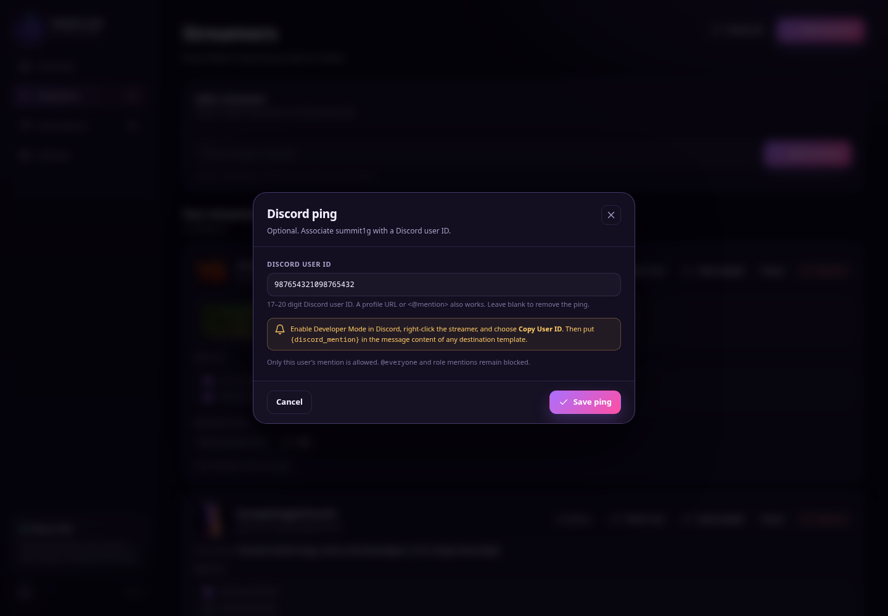

# Twitch Live to Discord


**A cross-platform, dark dashboard that sends Twitch live alerts to the Discord
channels your community actually uses.**

Runs on **Windows, Linux, and macOS** — Windows is not required. The dashboard
is served locally in your browser; Windows adds a native system-tray wrapper. The
whole app is a single static Go binary — no Electron, Node, Python, or external
runtime.

Add as many streamers and labelled Discord webhooks as you want, choose who
posts where, and tune each message with placeholders and a live Discord preview.

[Download the latest release](../../releases/latest) · [Build from source](#building-from-source) · [MIT License](LICENSE)

<br clear="right">


## Why people like it

- **Cross-platform by design.** Windows, Linux, and macOS use the same
  dashboard and monitor. Windows gets an optional tray icon and startup entry.
- **No Twitch login, bot, or API registration.** Just a Twitch username and a
  Discord webhook.
- **No hardcoded limits.** Follow every channel your community cares about and
  send alerts to multiple Discord servers or channels.
- **Labelled destinations.** Name webhooks things like `Community #live`,
  `Friends & family`, or `Speedruns`.
- **Your message, your style.** Edit the message content, embed title,
  description, footer, colour, fields, and preview image. Use placeholders and
  see a live Discord preview before saving.
- **Dark by default.** A polished dashboard with a light-mode toggle.
- **Once per stream, per destination.** Restarting the app does not repost the
  same stream. A new stream triggers a new alert.
- **Optional streamer pings.** Associate a streamer with their Discord user ID
  and use `{discord_mention}` in a destination template. `@everyone` and role
  mentions stay blocked.
- **No accidental pings.** Only the streamer you explicitly configure can be
  mentioned, so a stream title cannot accidentally ping the whole server.

## Runs on

| Platform | Dashboard | Background mode | Native tray |
| --- | --- | --- | --- |
| **Windows 10/11 x64** | Browser at `127.0.0.1` | Tray app / Start with Windows | Yes |
| **Linux x64** | Browser at `127.0.0.1` | `--serve` with systemd | No |
| **macOS Intel / Apple Silicon** | Browser at `127.0.0.1` | `--serve` with launchd | No |
| **Docker (amd64/arm64)** | Port `8787` | `restart: unless-stopped` | No |

Any 64-bit desktop with a modern browser can run the dashboard. Other Go
architectures can be built from source.

## Quick start

### Windows

1. Download `TwitchLiveNotifier.exe` from the
   [latest release](../../releases/latest).
2. Run it. The dashboard opens in your browser.
3. Leave it running in the tray. Windows SmartScreen may warn because the
   executable is unsigned.

### Linux

1. Download the Linux x64 archive from the
   [latest release](../../releases/latest), or run `./build-linux.sh`.
2. Extract it and start the dashboard:
   ```bash
   ./TwitchLiveNotifier-linux-amd64 --serve
   ```
3. Open the URL it prints, normally <http://127.0.0.1:8787/>.

### macOS

1. Download the macOS archive from the
   [latest release](../../releases/latest), or run `./build-macos.sh`.
2. Start the dashboard:
   ```bash
   ./TwitchLiveNotifier-macos-arm64 --serve   # Apple Silicon
   ./TwitchLiveNotifier-macos-amd64 --serve   # Intel
   ```
3. Open the URL it prints, normally <http://127.0.0.1:8787/>.

Then, on any platform:

1. Click **Add destination** and paste a Discord webhook URL.
2. Click **Add streamer** and enter a Twitch username or channel URL.
3. On the streamer card, tick the destinations where that streamer should post.
4. Use **Send sample** to post a clearly marked example, or **Check all now** to
   run a real check.
5. Leave the app running. On Windows that means the tray; on Linux/macOS keep
   `--serve` running as a background service.

### Docker (24/7 self-hosting)

For a VPS, NAS, or Raspberry Pi, run the published multi-arch image:

```bash
git clone https://github.com/ausbitbank/twitch-live-notifier.git
cd twitch-live-notifier
docker compose up -d
```

The dashboard is on <http://127.0.0.1:8787/> by default and settings live in a
persistent volume. The container includes a healthcheck against `/healthz`.
See [docs/docker.md](docs/docker.md) for public-access warnings, SSH tunnels,
updating, backups, ARM notes, and timezone setup for quiet hours.

### Creating a Discord webhook

1. Open Discord and go to your server.
2. Open **Server Settings → Integrations → Webhooks**.
3. Click **New Webhook**, choose the channel, and give it a name.
4. Click **Copy Webhook URL**.
5. Paste it into the destination editor and click **Test webhook**.
6. You need the **Manage Webhooks** permission in that server.

## Destinations and streamer routing

- A **destination** is a labelled Discord webhook. It has its own enabled state
  and message template.
- A **streamer** is a Twitch channel. Each streamer has a checklist of
  destinations.
- The same streamer can post to many destinations. The same destination can
  receive many streamers.
- Pausing a streamer stops automatic checks for it. Pausing a destination stops
  posts to that webhook without losing its template or connections.


## Message templates

Each destination has its own template. The editor includes a live Discord-style
preview using real channel data when available.

| Placeholder | Value |
| --- | --- |
| `{streamer}` | Twitch display name |
| `{title}` | Current stream title |
| `{game}` | Game or category |
| `{url}` | Twitch channel URL |
| `{thumbnail}` | Twitch preview image URL |
| `{viewers}` | Viewer count with thousands separators |
| `{started}` | Stream start date and time |
| `{live_for}` | How long the stream has been live, or `Ended` for a sample |
| `{webhook}` | Destination label |
| `{channel}` | Twitch login name |
| `{discord_mention}` | The streamer's Discord ping, or `@DisplayName` if no ID is set |

You can also toggle the author, preview image, game field, viewers field, and
live-time field, and choose the embed colour. Unknown placeholders are flagged
in the preview so typos are easy to spot.


## Optional Discord pings

Each streamer can have an optional Discord user ID. When configured, the
`{discord_mention}` placeholder becomes a real `<@user>` mention that pings the
streamer in Discord.

1. In Discord, open **Settings → Advanced** and enable **Developer Mode**.
2. Right-click the streamer's name and choose **Copy User ID**.
3. In the app, open **Streamers**, click **Add** next to **Discord ping**, and
   paste the ID.
4. Add `{discord_mention}` to the **message content** of a destination template.

Only that one user mention is allowed. `@everyone` and role mentions remain
blocked. If a streamer has no Discord ID, `{discord_mention}` falls back to plain
`@DisplayName` text and does not ping anyone.



## Monitoring

- The default check interval is **2 minutes**. You can change it in Settings.
- Monitoring runs from the app process, even if the browser tab is closed.
- The app checks every enabled streamer and posts to each connected destination
  only once per Twitch stream.
- Use **Check all now** for an immediate pass, or **Check now** on one streamer.
- **Pause monitoring** stops automatic checks but still allows manual checks.
- On Windows, **Start with Windows** launches the app quietly in the tray.
  Linux and macOS use systemd/launchd as described below.
- `GET /healthz` reports whether the monitor is alive, with the last check time,
  uptime, pause state, and counts. It returns HTTP 503 when checks are stale.
  Docker uses this endpoint for its built-in healthcheck.

## Settings and privacy

Settings are stored in the current user's profile:

| Platform | Settings file |
| --- | --- |
| Windows | `%APPDATA%\TwitchLiveNotifier\config.json` |
| Linux | `~/.config/TwitchLiveNotifier/config.json` |
| macOS | `~/Library/Application Support/TwitchLiveNotifier/config.json` |

The file contains your streamers, labelled webhook URLs, routing choices,
templates, and the last stream posted to each destination. A Discord webhook URL
is a credential: anyone with it can post to that channel. Keep the file private
and do not share unmasked screenshots or bug reports.

The app has no analytics, telemetry, or auto-updater. It talks directly to
Twitch and Discord. The dashboard is served only on `127.0.0.1` and is not
exposed to your network. Twitch is checked through Twitch's public web GraphQL
endpoint; no Twitch account or OAuth token is used.

## Running in the background on Linux/macOS

The `--serve` mode is intentionally simple. To keep it running at login, use the
service manager built into your OS.

### Linux systemd

```ini
[Unit]
Description=Twitch Live to Discord dashboard
After=network-online.target
Wants=network-online.target

[Service]
ExecStart=/path/to/TwitchLiveNotifier-linux-amd64 --serve
Restart=on-failure

[Install]
WantedBy=default.target
```

Save as `~/.config/systemd/user/twitch-live-notifier.service`, then:

```bash
systemctl --user daemon-reload
systemctl --user enable --now twitch-live-notifier
xdg-open http://127.0.0.1:8787/
```

### macOS launchd

Create `~/Library/LaunchAgents/com.twitch-live-to-discord.plist`:

```xml
<?xml version="1.0" encoding="UTF-8"?>
<!DOCTYPE plist PUBLIC "-//Apple//DTD PLIST 1.0//EN"
  "http://www.apple.com/DTDs/PropertyList-1.0.dtd">
<plist version="1.0">
<dict>
  <key>Label</key><string>com.twitch-live-to-discord</string>
  <key>ProgramArguments</key>
  <array>
    <string>/path/to/TwitchLiveNotifier-macos-arm64</string>
    <string>--serve</string>
  </array>
  <key>RunAtLoad</key><true/>
</dict>
</plist>
```

Then load it:

```bash
launchctl load ~/Library/LaunchAgents/com.twitch-live-to-discord.plist
open http://127.0.0.1:8787/
```

## Command line

The dashboard is the normal way to use the app. These modes are useful for
diagnostics and background setups:

```text
TwitchLiveNotifier[.exe]
    Windows: open the dashboard and keep monitoring in the tray.

TwitchLiveNotifier[.exe] --background
    Windows: start in the tray without opening the browser. Used at login.

TwitchLiveNotifier[.exe] --check
    Check every streamer once, post any pending alerts, and exit.

TwitchLiveNotifier[.exe] --serve
    Linux/macOS: run the dashboard in the foreground. Open the printed URL.

TwitchLiveNotifier[.exe] --healthcheck
    Probe the local /healthz endpoint and exit. Used by Docker.
```

Options:

| Option | Description |
| --- | --- |
| `--config PATH` | Use a custom settings file. |
| `--listen ADDR` | Dashboard listen address, e.g. `127.0.0.1:8787` or `0.0.0.0:8787`. |
| `--healthcheck-url URL` | Health URL used by `--healthcheck`. |
| `--version` | Print the version. |
| `--help`, `-h` | Show help. |

## Building from source

Requires Go 1.22 or newer.

Cross-compile Windows from Linux/macOS:

```bash
./build.sh
```

Windows PowerShell:

```powershell
.\build.ps1
```

The Windows result is written to `dist/TwitchLiveNotifier.exe`. The icon,
manifest, and version metadata are embedded from `rsrc_windows_amd64.syso`.

Linux build:

```bash
./build-linux.sh
```

macOS builds:

```bash
./build-macos.sh
```

The release workflow builds Windows x64, Linux x64, and macOS Intel/Apple
Silicon artifacts from a tag.

To regenerate the app icon, web assets, and Windows resources after changing
the artwork or version:

```bash
./tools/generate-resources.sh
```

This requires `go-winres` and ImageMagick.

## Limitations

- Requires an internet connection.
- Twitch can change its private web endpoint or public web client ID at any
  time. If that happens, the app will need an update.
- Discord webhook URLs are stored locally in the settings file in plain text.
- The Windows executable is unsigned, so Windows SmartScreen may warn on first
  launch.
- Windows includes a native tray icon. Linux and macOS currently run as a local
  browser dashboard and do not have native tray integration.
- Prebuilt artifacts are 64-bit Windows/Linux and Intel/Apple Silicon macOS.
  Other Go targets can be built from source.

## Roadmap and research

- [Public roadmap](docs/roadmap.md)
- [Competitive research and sources](docs/competitive-research.md)
- [Clean-session project brief](docs/project-context.md)

Issues and feature suggestions are welcome.

## Disclaimer

Twitch and Discord are trademarks of their respective owners. This project is
not affiliated with or endorsed by Twitch or Discord.

## License

MIT. See [LICENSE](LICENSE).
